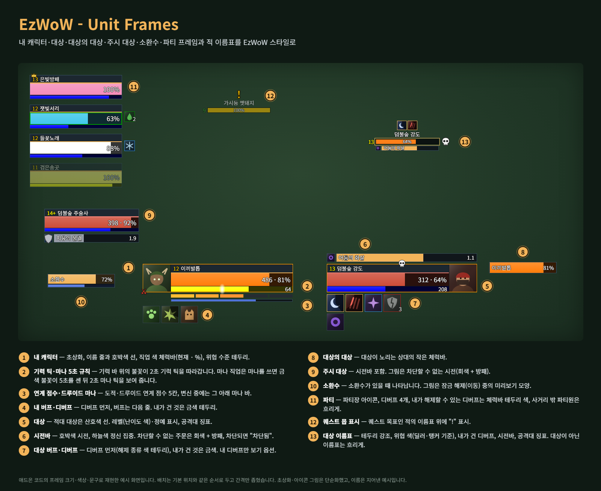
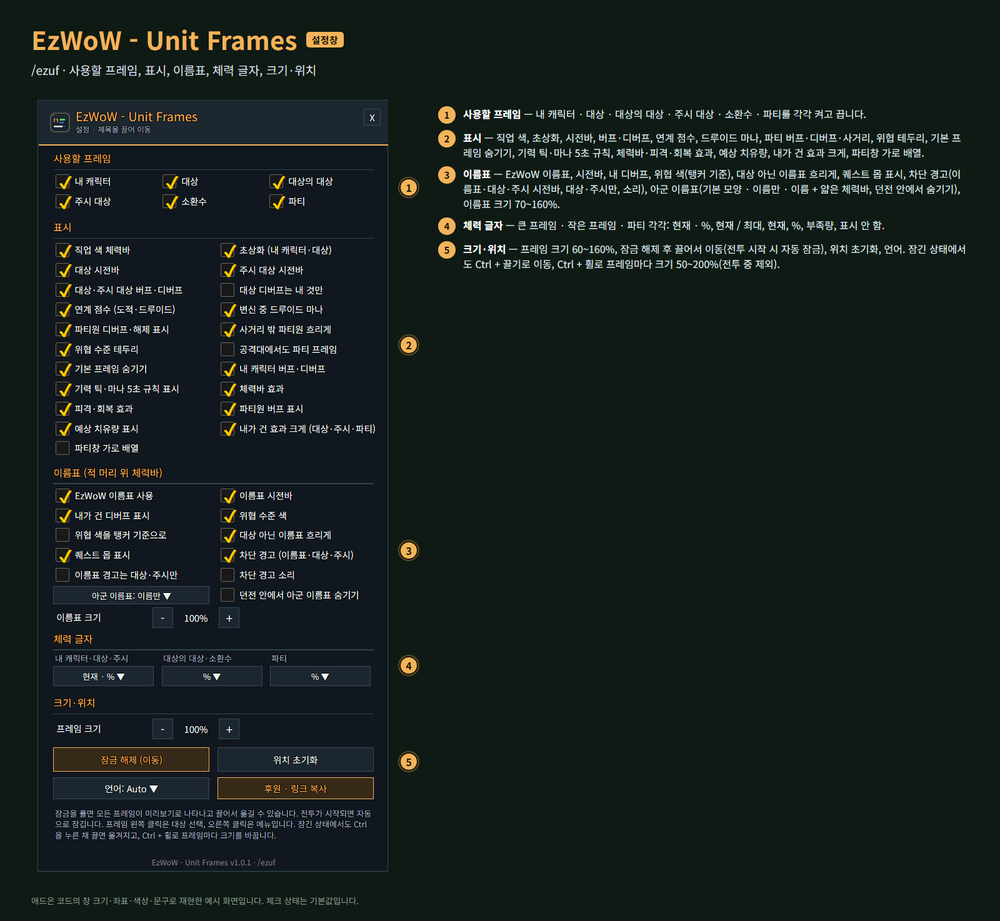
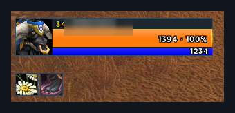
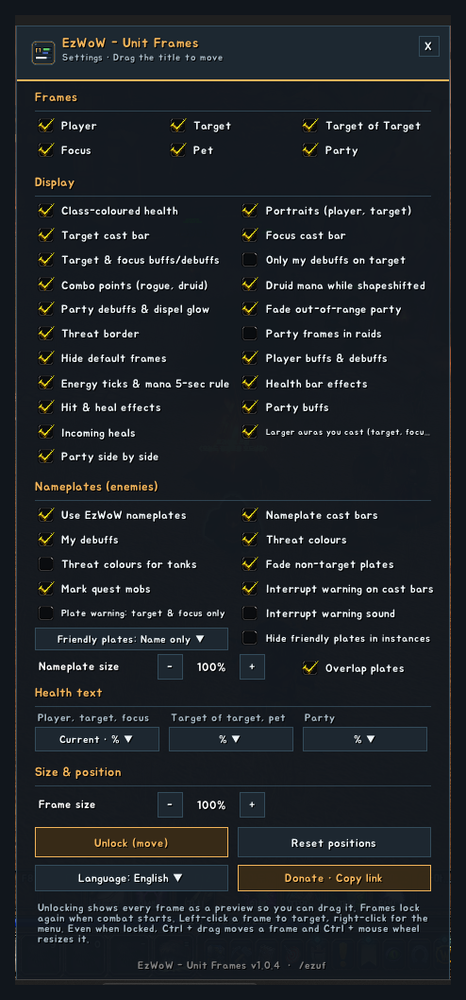

# EzWoW - Unit Frames

내 캐릭터·대상·대상의 대상·주시 대상·소환수·파티 체력바와 적·아군 이름표를 깔끔한 EzWoW 스타일로 바꿉니다.
Clean EzWoW-style player, target, target of target, focus, pet and party frames, plus enemy and friendly nameplates.

- 명령어 / Commands: `/ezuf`, `/유닛프레임` (`/ezuf 이동` · `/ezuf 잠금` · `/ezuf 초기화` · `/ezuf lang ko`)

## 한국어

### 화면 미리보기

> 실제 게임 화면입니다(WoW Forever, 한국어 클라이언트). 캐릭터 · 다른 플레이어 이름과 채팅 내용은 가렸습니다.

### 프레임
- 내 캐릭터 · 대상 · 대상의 대상 · 주시 대상 · 소환수 · 파티(4명). 각각 켜고 끌 수 있습니다.
- 왼쪽 클릭은 대상 선택, 오른쪽 클릭은 메뉴입니다. 마우스를 올리면 툴팁이 나옵니다.

### 편의 기능
- 직업 색 체력바, 체력 글자 형식 선택(현재 · %, 현재 / 최대, 현재, %, 부족량, 표시 안 함). 큰 프레임 · 작은 프레임 · 파티를 따로 고릅니다.
- **기력 틱·마나 5초 규칙**: 기력 바 위의 불꽃이 2초 기력 틱을 따라갑니다. 마나를 쓰면 금색 불꽃이 5초를 센 뒤 2초 마나 틱을 보여 줍니다.
- 대상·주시 대상 시전바(프레임 위, 차단할 수 없는 주문은 회색 + 방패 표시, 차단되면 "차단됨")
- 대상·주시 대상 버프·디버프(프레임 아래, 내가 건 것은 금색 테두리, 내 디버프만 보기 옵션), 내 캐릭터 버프·디버프
- **내가 건 효과 크게**: 대상·주시 대상에서는 내가 건 효과를 1.4배 크기로 첫 줄에, 파티원 버프 줄에서는 내가 건 버프를 앞에 크게 보여 줍니다.
- **예상 치유량**: 들어오는 치유가 체력바 뒤로 이어집니다(내 치유는 초록, 다른 사람의 치유는 하늘색).
- 연계 점수(도적·드루이드), 변신 중 드루이드 마나
- 파티원 버프 줄(프레임 아래)·디버프 아이콘(오른쪽 4개)과 내가 해제할 수 있는 디버프 테두리 표시, 사거리 밖 파티원 흐리게
- 파티창 가로 배열(선택): 파티원을 옆으로 나란히 놓고 디버프는 프레임 위에 표시합니다.
- **체력바 효과**: 광택·전투 중 맥동·낮은 체력 경고, 맞을 때 빨간 잔상과 번쩍임, 회복 때 초록 잔상
- 위협 수준 테두리, 공격대 징표·파티장·전투·휴식 아이콘, 정예·희귀 표시

### 이름표 (적 머리 위 체력바)
- 위협 수준 색(딜러 기준 / 탱커 기준), 시전바(차단 불가 표시), 내가 건 디버프, 레벨·정예 표시, 공격대 징표
- **퀘스트 몹 표시**: 퀘스트 목표인 적의 이름표 위에 "!"가 나타납니다.
- 현재 대상은 테두리 강조, 대상이 아닌 이름표는 흐리게, 이름표 크기 조절
- **차단 경고**: 차단할 수 있는 적의 시전은 이름표·대상·주시 시전바에 깜박이는 테두리와 "차단!"으로 알려 줍니다. 내 차단 기술이 재사용 대기 중이면 보라색입니다. 이름표는 대상·주시만 경고하는 옵션과 소리 옵션이 있습니다.
- **아군 이름표**: 기본은 이름만(플레이어는 직업 색, NPC는 관계 색). 파티·공격대원은 이름이 더 크고 왼쪽에 파티 표시(파티장은 왕관)가 붙습니다. 이름 + 얇은 체력바나 기본 모양도 고를 수 있습니다. 던전 안에서는 게임 설정만 쓰며, 아군 이름표를 숨기는 옵션이 있습니다.
- **이름표 겹쳐 표시**(기본 켬): 이름표가 위로 쌓여 밀려나지 않고 각자 유닛 머리 위에 그대로 있습니다.
- 게임 기본 이름표의 위치·클릭은 그대로 두고 모양만 바꿉니다.

### 위치·크기
- 설정에서 **잠금 해제**를 누르면 모든 프레임이 미리보기로 나타나고 끌어서 옮길 수 있습니다. 전투가 시작되면 자동으로 잠깁니다.
- **잠긴 상태에서도** Ctrl을 누른 채 끌면 프레임을 옮기고, Ctrl + 마우스 휠로 프레임마다 크기(50~200%)를 바꿉니다. 전투 중에는 동작하지 않습니다.
- 전체 프레임 크기(60~160%), 위치 초기화(프레임별 크기도 되돌림), 기본 프레임 숨기기.

<!-- ezwow-pad-share -->
### 게임패드
- 게임패드 UI를 켜면 EzWoW 창을 패드로 다룰 수 있습니다. 방향키로 이동, A(✕)로 누르기, X(□)로 오른쪽 클릭, LB/RB로 스크롤, B(○)로 닫기입니다. 창 아래에 연결된 패드 모양으로 키 안내가 나옵니다.
- 블리자드 창이 열려 있지 않을 때 **보기(Back) / Create 버튼**을 누르면 화면의 EzWoW 프레임(유틸리티 바, 퀘스트 목록 등)으로 이동합니다. 다시 누르거나 B를 누르면 돌아갑니다.
- 다른 버튼을 쓰려면 설정 > 단축키 > 애드온 > EzWoW > "게임패드: EzWoW 창으로 이동/돌아가기"에 지정합니다(EzWoW-MapFinder가 설치돼 있을 때).

### 기록 공유
- 모든 EzWoW 애드온이 함께 쓰는 기록 공유가 **기본으로 켜져 있습니다**. 직접 확인한 퀘스트 NPC, 희귀 몬스터 목격, 아이템 드롭, 채집 위치를 다른 EzWoW 사용자와 나눕니다.
- `/ezshare` 또는 `/공유`: `on` / `off` 켜기·끄기, `channel on` / `channel off` 서버 채널 사용, `status` 현재 상태와 기록 수.

## English

### Screenshots

> In-game screenshots with the addon set to English. The game client is Korean, so game text such as zone, item and spell names stays Korean. Character and player names and chat text are blurred.

### Frames
- Player, target, target of target, focus, pet and party (4). Each can be turned off.
- Left-click targets, right-click opens the menu, mouse-over shows the tooltip.

### Features
- Class-coloured health, health text formats (current · %, current / max, current, %, deficit, hidden), set separately for big frames, small frames and party
- **Energy ticks & mana 5-second rule**: a spark on the energy bar follows the 2-second energy tick. After you spend mana, a gold spark counts the 5 seconds, then shows the 2-second mana ticks.
- Target and focus cast bars (above the frame; uninterruptible casts are grey with a shield; "Interrupted" on kicks)
- Target and focus buffs and debuffs (below the frame; yours have a gold border; option to show only your debuffs), player buffs and debuffs
- **Larger auras you cast**: on the target and focus your own auras lead at 1.4x size; in the party buff row your own buffs come first, larger.
- **Incoming heals**: heals on the way continue the health fill (yours green, others' light blue).
- Combo points (rogue, druid) and druid mana while shapeshifted
- Party buff row (under the frame) and debuff icons (4, on the right), a glow for debuffs you can dispel, faded out-of-range members
- Party side by side (optional): members in a row, with debuffs above each frame.
- **Health bar effects**: gloss, a combat pulse and low-health warning, a red trail and flash when hit, a green trail when healed
- Threat border, raid marker, leader, combat and resting icons, elite and rare tags

### Nameplates (enemies)
- Threat colours (DPS or tank view), cast bars (uninterruptible shown), your debuffs, level and elite tags, raid markers
- **Quest mob marker**: a "!" above enemies you need for a quest.
- The current target is outlined, other plates can fade, adjustable size
- **Interrupt warning**: interruptible enemy casts get a pulsing rim and "Kick!" on nameplate, target and focus cast bars, purple while your interrupt is on cooldown. Options: plates warn for target & focus only, and a sound.
- **Friendly nameplates**: name only by default (class colour for players, reaction colour for NPCs; party and raid members get a larger name with a group mark, a crown for the leader), or name + thin health bar, or the default look. Inside instances only the game's own settings are used, with an option to hide friendly plates there.
- **Overlap plates** (on by default): plates stay over their units instead of stacking upward.
- The game's own plates keep their positions and clicks; only the look changes.

### Position & size
- **Unlock** in the settings shows every frame as a preview so you can drag it; frames lock again when combat starts.
- **Even when locked**, Ctrl + drag moves a frame and Ctrl + mouse wheel resizes it (50-200%, per frame). Not in combat.
- Overall frame size (60-160%), reset positions (also resets per-frame sizes), hide the default frames.

### Gamepad
- With the gamepad UI on, EzWoW windows work with a gamepad: D-pad to move, A (✕) to press, X (□) for right-click, LB/RB to scroll, B (○) to close. A key guide in your pad's button style shows under the window.
- With no game window open, press **View (Back) / Create** to move to the EzWoW frames on screen (Utility Bar, quest list and more). Press it again or B to go back.
- To use another button, set Key Bindings > AddOns > EzWoW > "Gamepad: move to / leave the EzWoW frames" (with EzWoW-MapFinder installed).

### Record sharing
- Record sharing, used by all EzWoW addons, is **on by default**. Quest NPCs, rare monster sightings, item drops and gathering spots you have seen yourself are shared with other EzWoW users.
- `/ezshare`: `on` / `off` to turn it on or off, `channel on` / `channel off` for the server channel, `status` for the current state and record counts.

---

## Support / 후원

If you find this addon useful, you can support its development.

애드온이 도움이 되셨다면 개발 후원으로 응원해 주세요.

[Buy Me a Coffee ☕](https://buymeacoffee.com/qqhrqqhr2)

