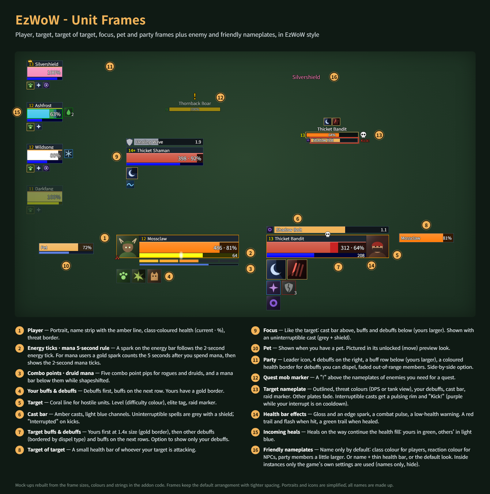
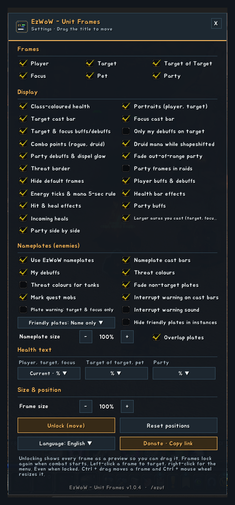
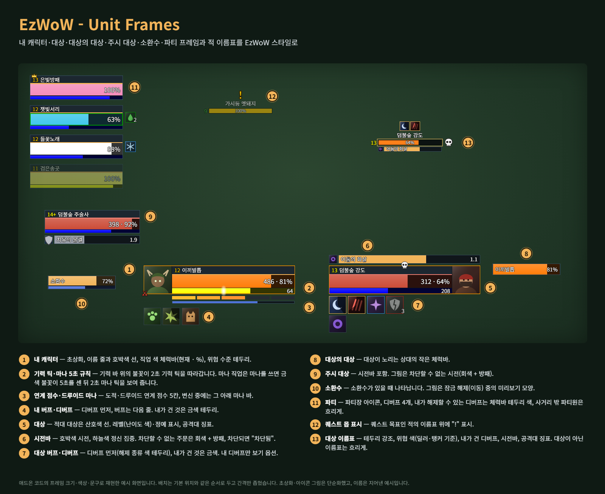
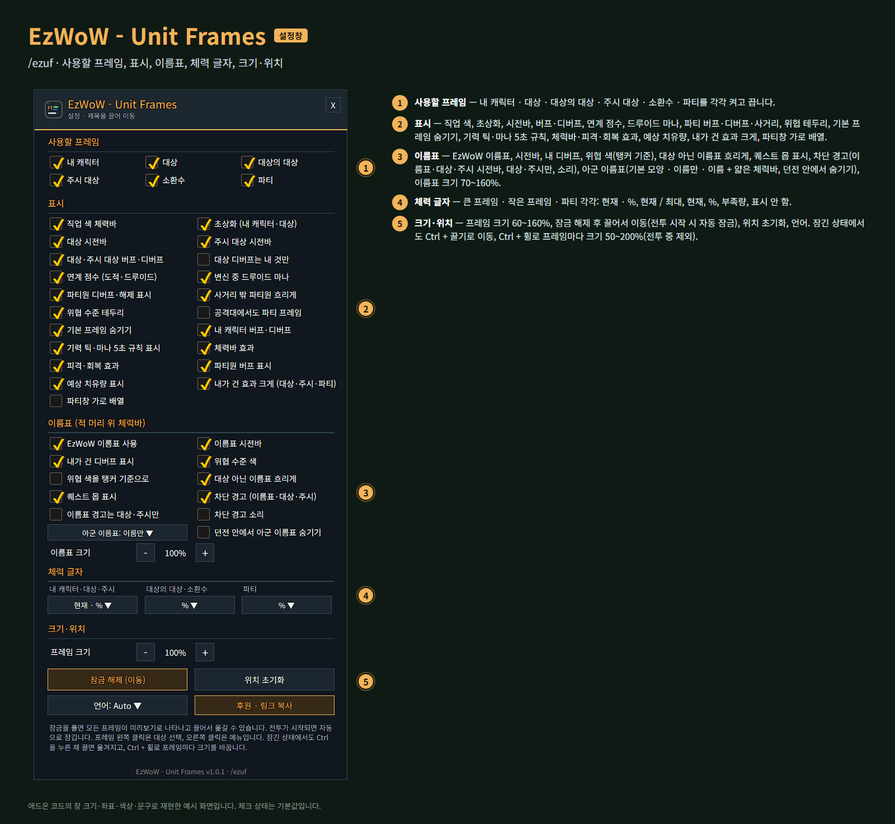

<!--
CurseForge summary (EN): Clean player, target, target of target, focus, pet and party frames with cast bars, auras, incoming heals and health effects, plus enemy nameplates.
CurseForge summary (KO): 내 캐릭터·대상·대상의 대상·주시 대상·소환수·파티 프레임(시전바·버프·예상 치유량·체력바 효과)과 적 이름표를 깔끔한 EzWoW 스타일로.
-->

# EzWoW - Unit Frames

**English** · [한국어](#한국어)

Clean unit frames for WoW Forever: player, target, target of target, focus, pet and party, plus enemy and friendly nameplates. Cast bars, buffs and debuffs, incoming heals, energy and mana ticks, combo points and lively health bars, all in the EzWoW style.

*Mock-ups rebuilt from the frame sizes, coordinates, colours and strings in the addon code. Portraits and icons are simplified; all names are made up.*

## Features

### Frames
- Player, target, target of target, focus, pet and party (4). Each can be turned off.
- Left-click targets, right-click opens the menu, mouse-over shows the tooltip.
- Class-coloured health, health text formats (current · %, current / max, current, %, deficit, hidden) for big frames, small frames and party, threat border, raid marker, leader, combat and resting icons, elite and rare tags.

### Casts and auras
- Target and focus cast bars above the frame; uninterruptible casts are grey with a shield, "Interrupted" on kicks.
- Target and focus buffs and debuffs below the frame, debuffs bordered by dispel type. Option to show only your debuffs.
- **Larger auras you cast**: your own auras lead at 1.4x size on the target and focus, and come first in the party buff rows.
- Your own buffs and debuffs under the player frame.

### Health bars
- **Incoming heals** continue the health fill: yours in green, others' in light blue.
- **Health bar effects**: gloss and an edge spark, a combat pulse and a low-health warning.
- **Hit & heal effects**: a red trail and flash when hit, a green trail when healed.

### Class helpers
- **Energy ticks & mana 5-second rule**: a spark follows the 2-second energy tick; after you spend mana a gold spark counts the 5 seconds, then shows the mana ticks.
- Combo points for rogues and druids, and druid mana while shapeshifted.

### Party
- Narrow party frames with 4 debuffs on the right and a buff row below, a coloured border for debuffs you can dispel, faded out-of-range members.
- Optional **side-by-side** layout (debuffs then sit above each frame), and party frames in raids.

### Nameplates (enemies)
- Threat colours (DPS or tank view), cast bars, your debuffs, level and elite tags, raid markers.
- **Quest mob marker**: a "!" above enemies you need for a quest.
- The current target is outlined, other plates can fade, adjustable size.
- **Interrupt warning**: interruptible enemy casts get a pulsing rim and "Kick!" on nameplate, target and focus cast bars, purple while your interrupt is on cooldown. Options: plates warn for target & focus only, and a sound.
- **Friendly nameplates**: name only by default (class colour for players, reaction colour for NPCs; party and raid members get a larger name with a group mark, a crown for the leader), or name + thin health bar, or the default look. Inside instances only the game's own settings are used, with an option to hide friendly plates there.
- **Overlap plates** (on by default): plates stay over their units instead of stacking upward.

### Moving and sizing
- **Unlock** in the settings to show every frame as a preview and drag it; frames lock again when combat starts.
- **Even when locked**, Ctrl + drag moves a frame and Ctrl + mouse wheel resizes it (50–200%, per frame), out of combat.
- Overall frame size 60–160%, reset positions, hide the default frames.

## Gamepad
- With the gamepad UI on, EzWoW windows work with a gamepad: D-pad to move, A (✕) to press, X (□) for right-click, LB/RB to scroll, B (○) to close. A key guide in your pad's button style shows under the window.
- With no game window open, press **View (Back) / Create** to move to the EzWoW frames on screen. Press it again or B to go back.
- To use another button: Key Bindings > AddOns > EzWoW > "Gamepad: move to / leave the EzWoW frames" (with EzWoW-MapFinder installed).

## Record sharing
- Shared by all EzWoW addons and **on by default**: quest NPCs, rare monster sightings, item drops and gathering spots you have seen yourself are shared with other EzWoW users.
- `/ezshare on` / `off`, `/ezshare channel on` / `off`, `/ezshare status`

## Commands
- `/ezuf` or `/유닛프레임` — settings
- `/ezuf unlock` · `/ezuf lock` — move frames / lock them
- `/ezuf reset` — reset positions
- `/ezuf lang auto|ko|en|de|fr|es|ru|cn|tw` — change the language

Languages: English, 한국어, Deutsch, Français, Español, Русский, 简体中文, 繁體中文.

---

## 한국어

WoW Forever용 유닛 프레임입니다. 내 캐릭터·대상·대상의 대상·주시 대상·소환수·파티 프레임과 적·아군 이름표를 깔끔한 EzWoW 스타일로 바꿉니다. 시전바, 버프·디버프, 예상 치유량, 기력·마나 틱, 연계 점수, 살아 있는 체력바 효과를 제공합니다.

*애드온 코드의 프레임 크기·좌표·색상·문구로 재현한 예시 화면입니다. 초상화·아이콘 그림은 단순화했고, 이름은 지어낸 예시입니다.*

## 기능

### 프레임
- 내 캐릭터 · 대상 · 대상의 대상 · 주시 대상 · 소환수 · 파티(4명). 각각 켜고 끌 수 있습니다.
- 왼쪽 클릭은 대상 선택, 오른쪽 클릭은 메뉴, 마우스를 올리면 툴팁.
- 직업 색 체력바, 체력 글자 형식(현재 · %, 현재 / 최대, 현재, %, 부족량, 표시 안 함: 큰 프레임 · 작은 프레임 · 파티 각각), 위협 수준 테두리, 공격대 징표·파티장·전투·휴식 아이콘, 정예·희귀 표시.

### 시전바와 버프·디버프
- 대상·주시 대상 시전바는 프레임 위. 차단할 수 없는 주문은 회색 + 방패, 차단되면 "차단됨".
- 대상·주시 대상 버프·디버프는 프레임 아래, 디버프는 해제 종류 색 테두리. 내 디버프만 보기 옵션.
- **내가 건 효과 크게**: 대상·주시 대상에서는 내가 건 효과를 1.4배 크기로 첫 줄에, 파티원 버프 줄에서는 맨 앞에 크게 보여 줍니다.
- 내 캐릭터 프레임 아래에 내 버프·디버프.

### 체력바
- **예상 치유량**: 들어오는 치유가 체력바 뒤로 이어집니다(내 치유는 초록, 다른 사람의 치유는 하늘색).
- **체력바 효과**: 광택과 가장자리 불꽃, 전투 중 맥동, 낮은 체력 경고.
- **피격·회복 효과**: 맞으면 빨간 잔상과 번쩍임, 회복되면 초록 잔상.

### 직업 도우미
- **기력 틱·마나 5초 규칙**: 불꽃이 2초 기력 틱을 따라가고, 마나를 쓰면 금색 불꽃이 5초를 센 뒤 마나 틱을 보여 줍니다.
- 도적·드루이드 연계 점수, 변신 중 드루이드 마나.

### 파티
- 폭이 좁은 파티 프레임, 오른쪽에 디버프 4개, 아래에 버프 줄, 내가 해제할 수 있는 디버프 테두리, 사거리 밖 파티원 흐리게.
- **가로 배열**(선택: 디버프는 프레임 위에 표시), 공격대에서도 파티 프레임 표시(선택).

### 이름표 (적 머리 위 체력바)
- 위협 수준 색(딜러 기준 / 탱커 기준), 시전바, 내가 건 디버프, 레벨·정예 표시, 공격대 징표.
- **퀘스트 몹 표시**: 퀘스트 목표인 적의 이름표 위에 "!".
- 현재 대상은 테두리 강조, 대상이 아닌 이름표는 흐리게, 이름표 크기 조절.
- **차단 경고**: 차단할 수 있는 적의 시전은 이름표·대상·주시 시전바에 깜박이는 테두리와 "차단!"으로 알려 줍니다. 내 차단 기술이 재사용 대기 중이면 보라색입니다. 이름표는 대상·주시만 경고하는 옵션과 소리 옵션이 있습니다.
- **아군 이름표**: 기본은 이름만(플레이어는 직업 색, NPC는 관계 색). 파티·공격대원은 이름이 더 크고 왼쪽에 파티 표시(파티장은 왕관)가 붙습니다. 이름 + 얇은 체력바나 기본 모양도 고를 수 있습니다. 던전 안에서는 게임 설정만 쓰며, 아군 이름표를 숨기는 옵션이 있습니다.
- **이름표 겹쳐 표시**(기본 켬): 이름표가 위로 쌓여 밀려나지 않고 각자 유닛 머리 위에 그대로 있습니다.

### 이동과 크기
- 설정에서 **잠금 해제**를 누르면 모든 프레임이 미리보기로 나타나고 끌어서 옮길 수 있습니다. 전투가 시작되면 자동으로 잠깁니다.
- **잠긴 상태에서도** Ctrl + 끌기로 이동, Ctrl + 마우스 휠로 프레임마다 크기(50~200%)를 바꿉니다(전투 중 제외).
- 전체 프레임 크기 60~160%, 위치 초기화, 기본 프레임 숨기기.

## 게임패드
- 게임패드 UI를 켜면 EzWoW 창을 패드로 다룰 수 있습니다. 방향키로 이동, A(✕)로 누르기, X(□)로 오른쪽 클릭, LB/RB로 스크롤, B(○)로 닫기입니다. 창 아래에 연결된 패드 모양으로 키 안내가 나옵니다.
- 블리자드 창이 열려 있지 않을 때 **보기(Back) / Create 버튼**을 누르면 화면의 EzWoW 프레임으로 이동합니다. 다시 누르거나 B를 누르면 돌아갑니다.
- 다른 버튼을 쓰려면: 설정 > 단축키 > 애드온 > EzWoW > "게임패드: EzWoW 창으로 이동/돌아가기" (EzWoW-MapFinder 설치 시)

## 기록 공유
- 모든 EzWoW 애드온이 함께 쓰며 **기본으로 켜져 있습니다**. 직접 확인한 퀘스트 NPC, 희귀 몬스터 목격, 아이템 드롭, 채집 위치를 다른 EzWoW 사용자와 나눕니다.
- `/ezshare on` / `off` (또는 `/공유`), `/ezshare channel on` / `off`, `/ezshare status`

## 명령어
- `/ezuf` 또는 `/유닛프레임` — 설정창
- `/ezuf 이동` · `/ezuf 잠금` — 프레임 이동 / 잠금
- `/ezuf 초기화` — 위치 초기화
- `/ezuf lang auto|ko|en|de|fr|es|ru|cn|tw` — 언어 바꾸기

지원 언어: English, 한국어, Deutsch, Français, Español, Русский, 简体中文, 繁體中文.

---

**Support:** If you find this addon useful, you can support its development. [Buy Me a Coffee ☕](https://buymeacoffee.com/qqhrqqhr2)

**후원:** 애드온이 도움이 되셨다면 개발 후원으로 응원해 주세요. [Buy Me a Coffee ☕](https://buymeacoffee.com/qqhrqqhr2)
